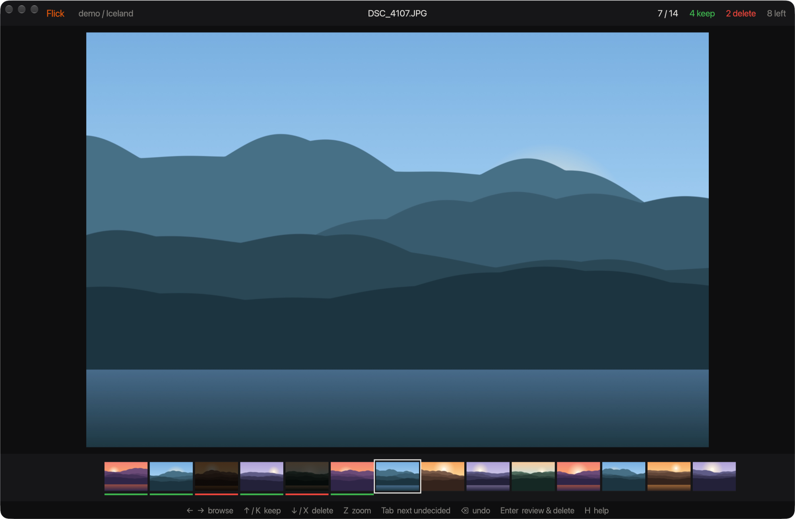
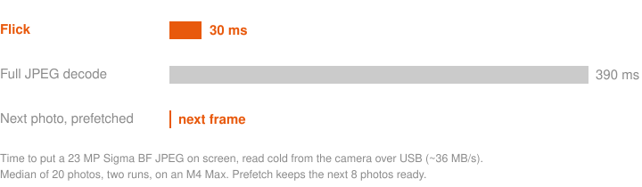

<h1 align="center">Flick</h1>

<p align="center">An extremely fast photo culler for macOS, written in Rust.</p>

<p align="center"></p>

Open a folder or camera card, then fly through it with the keyboard. ↑ keeps a photo, ↓ marks it for deletion, and each key moves straight to the next one. When you're done, one screen shows everything you marked, and Enter deletes it for good.

<p align="center"></p>

## Highlights

- **Next photo on the next frame.** The next 8 photos are decoded on background threads before you reach them. At 15 photos a second, 117 of 117 photos were on screen the frame after the keypress.
- **Reads 8% of each file, not 100%.** Camera JPEGs carry a smaller preview inside them. Flick reads only that preview, about 0.7 MB of an 8 MB file. It loads full resolution once you stop on a photo, so zoom is ready when you want it.
- **One key per decision.** ↑ keeps, ↓ marks for deletion, and both move on. ⌫ undoes. Tab jumps to the next photo you haven't decided on.
- **1:1 zoom for focus checks.** Z shows true pixels. Move the pointer to pan.
- **RAW + JPEG are one photo.** `BF_0001.JPG`, `BF_0001.DNG`, and `BF_0001.xmp` are one shot. Deleting removes all of them.
- **Nothing is lost if you quit.** Marks are saved in `~/Library/Application Support/Flick` as you make them, never on the card. Reopen the folder and you're back at the first undecided photo.
- **Small and native.** One 12 MB universal binary for Apple Silicon and Intel, drawn on the GPU. There's no runtime, no Electron, and no catalog to import into.

## What Flick leaves out

Flick does one job: deciding what to keep. It has no library, no import step, no ratings or color labels, no editing, and no export. Finder, Photos, and your editor already do those well. Keep the photos Flick leaves behind, then open them in whatever you use next.

## Install

Download `Flick.dmg` from the [latest release](https://github.com/HMDRAMS-DEV/flick/releases/latest) and drag Flick to Applications. It's signed and notarized, and runs on macOS 13 or later.

To open folders from a terminal, link the binary onto your `PATH`:

```sh
sudo ln -sf /Applications/Flick.app/Contents/MacOS/flick /usr/local/bin/flick
flick ~/Pictures/2026-10-10
```

You can also drop any folder on the window, or press O. A mounted camera card shows up on the start screen, and Enter opens it.

## Keys

| Key | Does |
|---|---|
| → or Space | Next photo |
| ← or ⇧Space | Previous photo |
| ↑ or K | Keep, then next |
| ↓ or X | Mark for deletion, then next |
| U | Clear the decision |
| ⌫ or ⌘Z | Undo the last decision |
| Z or click | Zoom to 100%. Move the pointer to pan |
| Tab, ⇧Tab | Next or previous undecided photo |
| Enter | Review marked photos, then delete them |
| F | Full screen |
| O | Open another folder |
| H or ? | All keys |

## Deleting is permanent

Deleting skips the Trash. The files are removed from the folder or card, so the space frees up right away. You never delete by accident from the cull screen: ↓ only marks a photo. Enter opens a review of every marked photo with the file count and total size. Click a photo there to keep it instead, and press Enter again to delete.

## How it's fast

- **Embedded previews.** Most cameras store a smaller JPEG inside each photo, in its MPF block or EXIF thumbnail. Flick finds it by parsing the file header and reads only those bytes. It skips HDR gain maps, which share the MPF block but aren't meant to be viewed. RAW files use a JPEG preview embedded in their TIFF structure.
- **A queue that follows you.** Every keypress replaces the decode queue in priority order: this photo, then the photos ahead in the direction you're moving, then visible thumbnails. Stale work never delays the photo on screen.
- **Nothing blocks the UI thread.** Disk reads, decoding, and color conversion happen on worker threads. The UI thread only uploads finished textures and draws.
- **The card is the limit.** Over a ~36 MB/s camera USB link, holding an arrow key (about 30 photos a second) outruns the card. Flick shows each photo's thumbnail while you fly, then sharpens it when you stop.

## Build

Requires Rust 1.88 or later.

```sh
cargo run --release -- ~/Pictures/some-folder
./build.sh             # target/Flick.app, universal
./build.sh --install   # also copies it to /Applications and links ~/.cargo/bin/flick
cargo run --release -- --bench /path/to/folder   # time scan and decode without a window
```

`scripts/release.sh` signs, notarizes, and publishes a release.

## License

MIT
